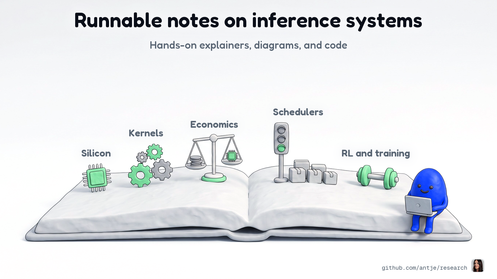
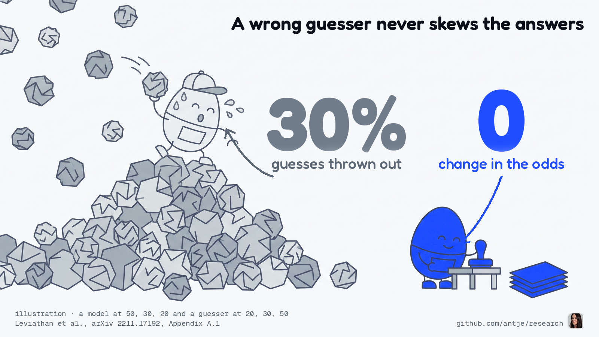

# research

Notes on how AI models run on real hardware, written so you can rerun them. Each post picks one
question about inference (the work of serving a trained model to its users), explains the mechanism
in plain words, draws it, and ships the code behind its numbers. Change a shape, swap a model, and
see what moves.

## What's inside

- **Heterogeneous inference**: splitting one model's work across different kinds of chips. Which part belongs where, and what does the handoff cost?
- **Kernels**: the small GPU programs that do the math. Is this one fast, is it correct, and how would you know?
- **Profilers**: the tools that show where a GPU spends its time. What are they telling you to fix?
- **Schedulers**: the part of a serving engine that decides which requests run together. Who waits, and what does batching buy?
- **RL and training infrastructure**: the loops that train models, and what keeps their GPUs busy.
- **Economics**: what a token costs on NVIDIA, AMD, Google TPU, AWS Trainium, Cerebras, and d-Matrix silicon, with the conditions written down.

## What every post has

- **An explainer** you can read in a few minutes, with each term defined where it first shows up.
- **A diagram** of the one idea that matters.
- **Code** in `code/`, with a README that says what it needs, how to run it, and what it printed.
- **Sources** for every number, so you can check the conditions yourself.

## Latest

**[Why a bad guesser can't skew what your model says](posts/2026-10-25-pm-bad-guesser-same-answer/)** · October 25, 2026

In speculative decoding a small guesser proposes the next tokens and the big target model checks them. With the exact rule, every answer keeps the target's odds for any guesser. Only speed changes.

## Earlier posts

| | |
|---|---|
|  | **[More batch won't make decode compute-bound](posts/2026-09-28-pm-decode-wants-sram/)** September 28, 2026 Each user's KV cache is read again every step, so Qwen2.5-72B decode on a B200 (BF16, 4,096 tokens) never passes 116 FLOP per byte against a ridge of 281. Measured, compute use flattens at 21.9%. |

Spotted a mistake, or got a different result? [Open an issue](https://github.com/antje/research/issues/new).
