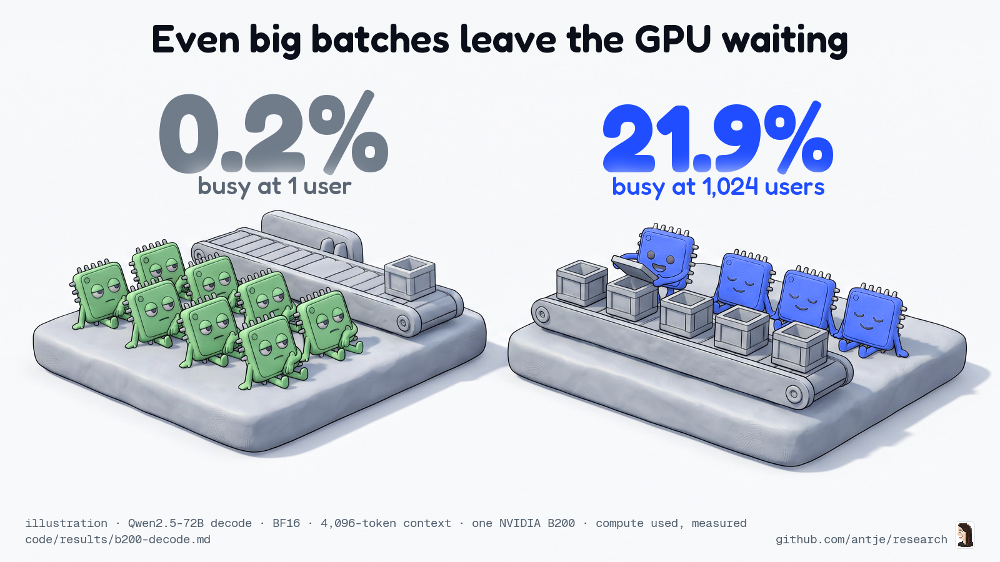
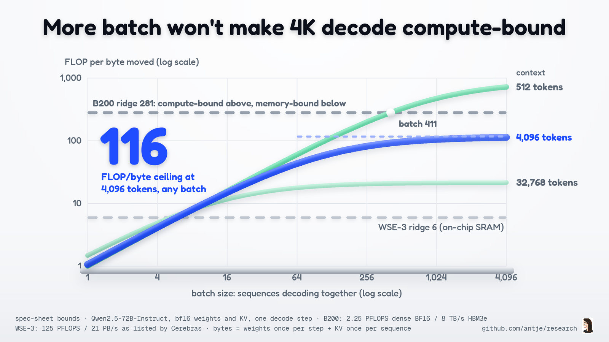

# More batch won't make decode compute-bound

**Each user's KV cache is read again every step, so Qwen2.5-72B decode on a B200 (BF16, 4,096 tokens) never passes 116 FLOP per byte against a ridge of 281. Measured, compute use flattens at 21.9%.**

*Antje Barth, September 28, 2026*



Gimlet Labs announced today that it's adding Cerebras wafer-scale chips to its inference cloud: 100 megawatts planned, up to 3,000 tokens per second. Why does a chip with 44 GB of memory earn a place next to GPUs with 180 GB? A roofline answers it.

## What one decode step reads

To generate one token, a dense transformer reads every weight once plus the KV cache of every sequence in the batch. Qwen2.5-72B-Instruct has 72.7B parameters, so that's 145.4 GB of weights per step in bf16. Its KV cache costs 320 KiB per token (80 layers, 8 KV heads, head dim 128, K and V in bf16), so 4,096 cached tokens add 1.3 GB. At batch 1 that's 0.16 TFLOP against 146.8 GB moved: 1.1 FLOP per byte.

A B200 does 2.25 PFLOPS of dense BF16 and moves 8 TB/s from HBM3e, which puts its ridge point at 281 FLOP per byte. Below it, memory is the limiter: at batch 1 the step spends 18 ms streaming weights, uses 0.4% of the tensor cores, and caps that one user at 55 tokens per second. No kernel beats it, because the bytes have to move.

## Batch helps, then stops helping

Batching amortizes the weight read, and the intensity climbs: 43 FLOP per byte at batch 64 (2,214 tokens per second for the batch, 15% of peak compute) and 105 at batch 1,024. (Those batches need tensor parallelism or FP8: bf16 weights leave 34.6 GB free, about 25 sequences of 4,096 tokens.) The KV read, though, grows by 1.3 GB per sequence and never amortizes. So the intensity converges to FLOPs per token over KV bytes per sequence: 116 FLOP per byte at 4,096 tokens.



That limit sits below the ridge, so no batch makes this decode compute-bound on a B200. The tell: tensor-core utilization climbs with batch, then flattens below 41% (limit over ridge). That's the KV read.

Shorter context helps: at 512 tokens the limit is 875 FLOP per byte, and batch 411 reaches the ridge. FP8 halves the bytes but also doubles the ridge to 562, so the ridge batch stays at 411 and the 4k limit (233) is still under it.

## What on-chip SRAM changes

SRAM-centric chips attack the ridge's denominator. Cerebras lists the WSE-3 at 125 petaflops and 21 petabytes per second of aggregate memory bandwidth, a ridge of 6 FLOP per byte. Batch 6 saturates it at 512, 4,096, or 32,768 tokens, while a B200 at batch 6 uses about 2% of its tensor cores. (Cerebras doesn't state the precision. If 125 petaflops includes sparsity, the dense ridge is nearer 3 FLOP per byte.)

The price is capacity. The WSE-3 has 44 GB of SRAM. A B200 has 126 MB of SRAM and 180 GB of HBM (Gimlet's post on SRAM-centric chips has the comparison). Qwen2.5-72B doesn't fit on one wafer in bf16 or fp8, but Qwen2.5-7B fits, with room for about 500,000 KV tokens. Larger models get spread across chips, or inference gets split so only the bandwidth-bound phase lands on SRAM. Gimlet's post calls the architecture suited to token generation.

## Measured on a B200

`code/` checks the spec-sheet roofline on one NVIDIA B200 (driver 580.173.02, CUDA 13.0, torch 2.13.0+cu130, clocks not locked): one Qwen2.5-72B decoder layer with random bf16 weights, timed with CUDA graphs and scaled to 80 layers. At batch 1 and 4,096 tokens, a layer takes 338 us against a bound of 222 us: 37 tok/s against 55, so plain PyTorch kernels get 66% of the way.

The tell shows up on the real chip. At 4,096 tokens, compute used goes 0.2%, 0.9%, 3.5%, 10.3%, 20.1%, and 21.9% for batch 1, 4, 16, 64, 256, and 1,024, and stops, well under the 41% ceiling. At 512 tokens they reach 43.3%. Attention per sequence floors at 2.28 us per layer, the time to stream that sequence's 16.8 MB of KV, while everything else per sequence keeps shrinking. The measured curve sits below the bound because attention and the matmuls run one after the other.

## Run it

```bash
cd code && uv run pytest -q && uv run python -m decode_roofline
# on a CUDA GPU, with torch installed:
cd code && python3 -m decode_roofline.gpu_decode
```

Chip numbers are derived in [`chips.py`](code/decode_roofline/chips.py), and the GPU script prints [`results/b200-decode.md`](code/results/b200-decode.md). The bound assumes one GPU, a dense model, one token per sequence per step, a full-context KV read, and peak bandwidth.

## Check your own decode

Before you buy batch for decode, divide FLOPs per token by KV bytes per sequence. If that sits below your chip's ridge, shrink the KV, keep less context, verify more than one token per step, or move decode to memory with a lower ridge. It bites because every sequence brings its own KV read, so those bytes grow with the batch and never amortize.

## Sources

- Gimlet Labs, "Scaling low-latency inference with Gimlet Cloud and Cerebras", Sep 28 2026: https://gimletlabs.ai/blog/cerebras-announcement
- Gimlet Labs, "The emerging role of SRAM-centric chips in AI inference", Mar 5 2026: https://gimletlabs.ai/blog/sram-centric-chips
- NVIDIA DGX B200 specifications (8 GPUs: 1,440 GB, 64 TB/s HBM3e. The page's footnote says its tensor-core specs are shown in sparse and dense is half): https://www.nvidia.com/en-us/data-center/dgx-b200/
- NVIDIA HGX B200 specifications (8 GPUs: FP16/BF16 36 PFLOPS, FP8 72 PFLOPS, read on the same sparse basis as the DGX page, so dense per GPU = 36 / 2 / 8): https://www.nvidia.com/en-us/data-center/hgx/
- Cerebras, WSE-3 press release (44 GB on-chip SRAM, 125 petaflops peak AI performance): https://www.cerebras.ai/press-release/cerebras-announces-third-generation-wafer-scale-engine
- Cerebras, "Introducing Cerebras Inference" (21 petabytes/s aggregate memory bandwidth): https://www.cerebras.ai/blog/introducing-cerebras-inference-ai-at-instant-speed
- Qwen2.5-72B-Instruct config and model card: https://huggingface.co/Qwen/Qwen2.5-72B-Instruct
- Qwen2.5-7B-Instruct config and model card: https://huggingface.co/Qwen/Qwen2.5-7B-Instruct
