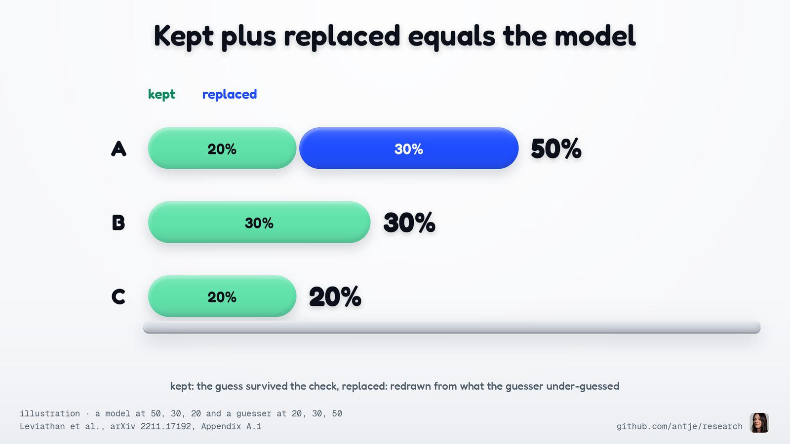
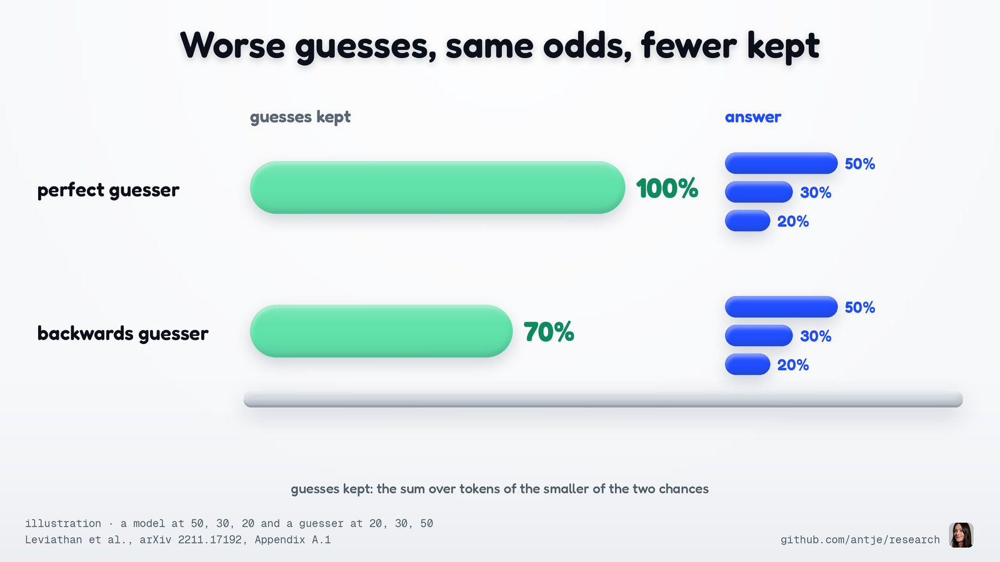
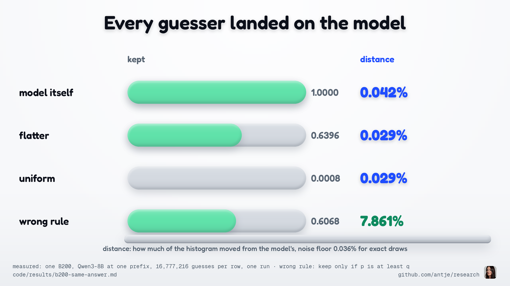
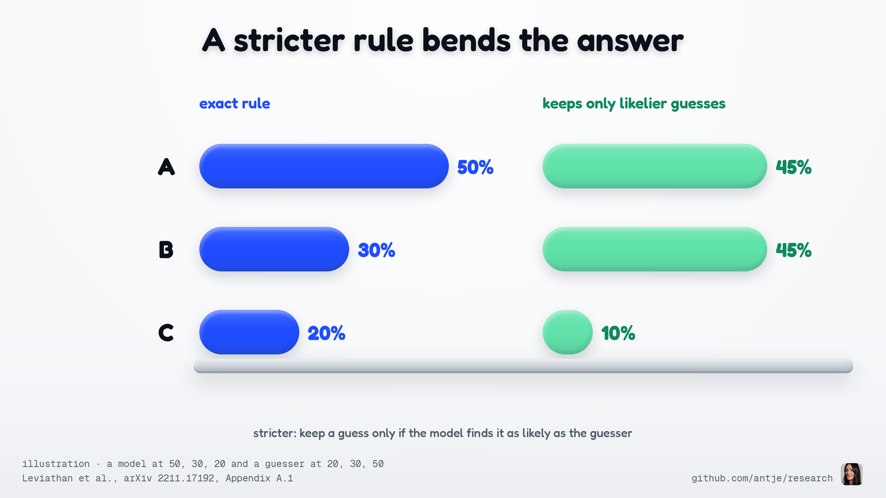
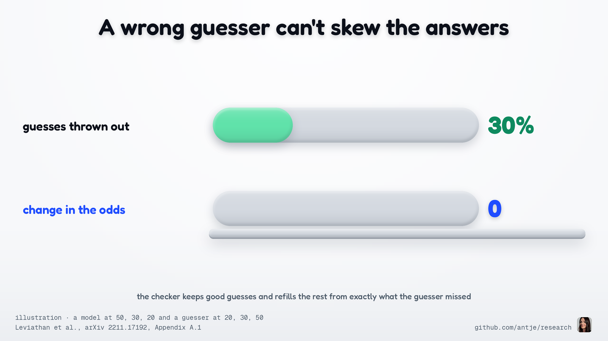
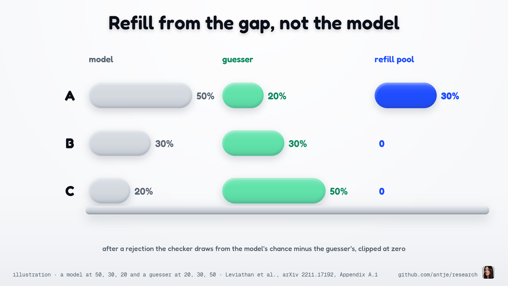
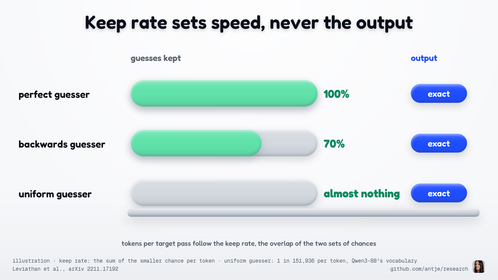
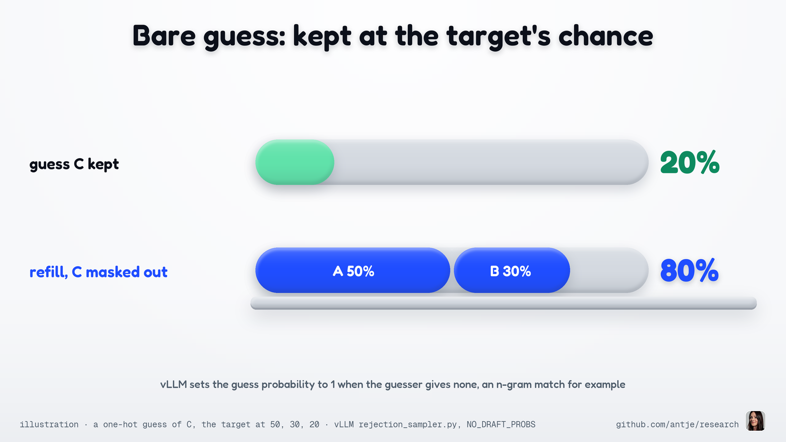
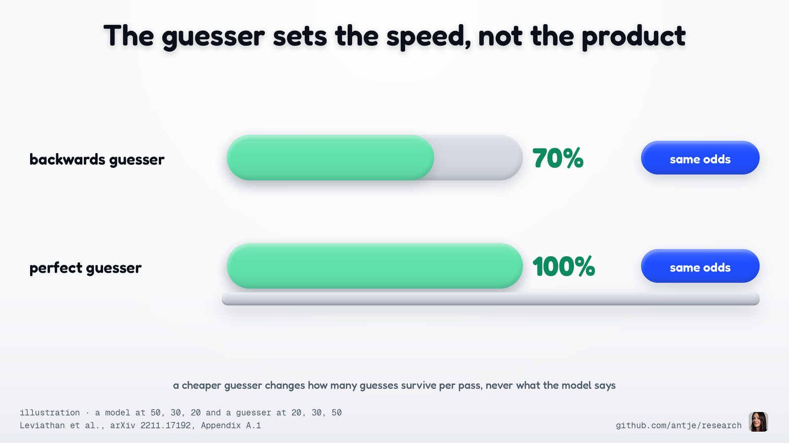
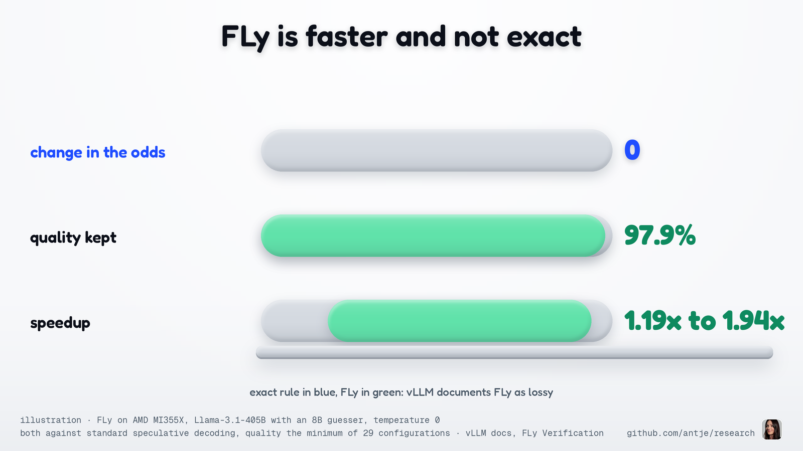

**HOW IT WORKS**

# Why a bad guesser can't skew what your model says

**In speculative decoding a small guesser proposes the next tokens and the big target model checks them. With the exact rule, every answer keeps the target's odds for any guesser. Only speed changes.**

*Antje Barth, October 25, 2026*


Speculative decoding speeds up a big model, the target, by letting a cheap guesser propose the next few tokens, which the target checks in one pass. The guesser is usually a small model, sometimes just a lookup that copies earlier text. It now ships with two kinds of checker. vLLM's documentation, updated October 23, lists the lossy FLy Verification beside the standard checker, and SGLang exposes thresholds that "accept more aggressively". The exact checker's guarantee: the guesser cannot shift the odds of any answer.

## The one fact

Leviathan, Kalman and Matias wrote the rule down in 2022. With q the guesser's probabilities and p the target's, the guesser samples a token from q. The checker keeps it with probability min(1, p/q). Otherwise it draws the replacement from p − q, clipped at zero and renormalized. Their Appendix A.1 shows in one sum that for any p and q the result is distributed as p.

## A guesser who gets the order backwards

Picture a target that picks A, B or C with chances 50, 30, 20, and a guesser who has it backwards: 20, 30, 50. The checker keeps A whenever proposed (50 ≥ 20) and B too (30 = 30), but C only 2 in 5 times (20 over 50). A guess survives 70% of the time: 20 + 30 + 20.

When C is thrown out, the checker draws not from the target but from p − q clipped at zero, 30% on A and nothing else, so every replacement is A.

Add it up. A: 20 kept plus 30 replaced, 50. B: 30 kept, 30. C: 50 proposed times 40% kept, 20.




## Why it adds up every time

In general a token is kept with chance q times min(1, p/q), which is min(p, q). It arrives as a replacement with chance p − min(p, q), because the pool is p − q clipped at zero and its total mass is one minus the keep rate. The two shares add to p, whatever q was.

## What a worse guesser costs, and what it doesn't

The keep rate, the share of guesses the checker keeps, is the overlap of the two distributions, the sum over tokens of min(p, q). A perfect guesser (q = p) keeps 100%. The backwards guesser keeps 70%. A uniform guess over Qwen3-8B's vocabulary gives every token a 1 in 151,936 chance, keeps almost nothing, and the answers keep the target's odds.



An n-gram guesser (it matches recent tokens against earlier text) gives a token and no probabilities, a q with all its mass on one token. The rule degrades to "keep with probability p of the guess", and vLLM's sampler does exactly that.

## Where the exactness goes

The guarantee comes with two conditions and one way to lose it. First, p must be exactly what plain decoding would sample: after penalties, masks and grammar constraints, then temperature, top-k and top-p. q must be the distribution the guess actually came from, after the guesser's own settings. Second, GPUs round. vLLM's guarantee holds "up to the precision limits of hardware numerics", and "changes in batch size may cause variations". The check runs a different batch shape than plain decoding, so even greedy output can drift. Same odds, not bit-identical tokens.

Third, and biggest: any rule that keeps a guess the exact rule would throw out changes the output. Medusa's typical acceptance keeps a candidate when the target's probability clears a threshold, calling a matched distribution "typically unnecessary". vLLM's FLy "is intentionally lossy": its page reports it faster than standard speculative decoding in all 40 primary configurations and a quality retention of 97.9% at worst over the 29 scored ones. SGLang's thresholds, default 1.0, "accept more aggressively" when lowered. Block verification (Sun et al.) is another exact rule that keeps more guesses.

## Measured on a B200

In one run on a B200 against Qwen3-8B's next-token distribution (temperature 1), 16.8 million guesses gave the target's histogram for every guesser. The keep rate ran from 1.0 to 0.0008, and every histogram stayed within the noise of exact draws. At one prompt, four wrong rules moved 7.9% to 10% of the mass. vLLM's kernel matched, and so did vLLM serving with its n-gram guesser, with and without penalties on repeated words. With greedy decoding (always the top token) and the guesser on, 134 of 256 answers differed from plain decoding, each first at a near tie. Plain runs matched each other. The run can't say whether rounding alone causes it.



## Run it

```bash
cd posts/2026-10-25-pm-bad-guesser-same-answer/code
CUDA_VISIBLE_DEVICES=0 python -m bad_guesser --quick   # torch, transformers, vLLM 0.31 and Qwen/Qwen3-8B cached; under a minute (the full run: about 8.5 minutes)
uv run --extra gpu pytest -q                           # the A, B, C example anywhere, the rule and vLLM's kernels on a GPU
```

## How to spot it

Sample thousands of tokens at positions a guess actually reached (in vLLM, never the first token), with and without speculation, at temperature 1. Compare against the spread of several plain runs, not one gap. A lossy checker shows outside it, usually as rarer tokens going missing. The intuitive wrong rule (keep only when the target finds the guess at least as likely as the guesser did, else sample fresh from the target) turns the example's 50, 30, 20 into 45, 45, 10.



## The rule

A guesser changes your speed, never your output distribution, as long as the checker keeps the min(1, p/q) accept and the clipped p − q refill, with p exactly what plain decoding would sample and q what the guesser actually sampled. It bites because every knob that keeps more guesses than the rule allows pays for speed with the target's distribution, and no accuracy benchmark will tell you by how much.

## What this means for you

### For the curious non-specialist



Speculative decoding lets a small model guess and a big one check. The checker keeps the good guesses and refills the rest from exactly what the guesser missed, so even a guesser that loses 30% of its guesses leaves the odds of every answer where the model put them.

### For ML and AI engineers



After a rejection the checker does not resample from the target. It draws from the target's chance minus the guesser's, clipped at zero: in the A, B, C example that is 30% on A and nothing else, which is exactly the gap the kept guesses left.

### For performance and capacity engineers



The keep rate is the overlap of the two distributions, and tokens per target pass follow it: a perfect guesser keeps everything, a uniform guess (a 1 in 151,936 chance per token over Qwen3-8B's vocabulary) keeps almost nothing. The output distribution is the same in every row.

### For CUDA and hardware folks



An n-gram or greedy guesser puts all its chance on one token. vLLM's rejection sampler then sets the guess probability to 1, keeps the guess with probability p, and draws the replacement from the target with the guessed token masked out. In the A, B, C example a guess of C is kept 20% of the time and the other 80% lands on A and B in the model's proportions.

### For VCs and business readers



The guesser is a speed knob. A weaker one keeps fewer guesses per pass, so the big model runs more often, and its answers come out with the same odds as when it runs alone.

### For analysts



vLLM now documents an exact checker and a lossy one side by side. The standard rule leaves the odds of every answer unchanged for any guesser. FLy reports speedups over standard speculative decoding in all 40 primary configurations on its page, across four pairs of model and guesser, and a quality retention of 97.9% at worst over the 29 configurations scored that way. It does not preserve the target distribution.

## Sources

- The B200 run: [`code/results/b200-same-answer.md`](code/results/b200-same-answer.md) and a second run on the host's other B200 with other seeds, [`code/results/b200-run2-same-answer.md`](code/results/b200-run2-same-answer.md), each ending in its Conditions line.

- Leviathan, Kalman and Matias, Fast Inference from Transformers via Speculative Decoding (arXiv 2211.17192, 2022, ICML 2023): § 2.3 the rule, Lemma 3.3 and Theorem 3.5 the acceptance rate as the overlap, Appendix A.1 the proof, Appendix A.5 lenience. https://arxiv.org/abs/2211.17192
- Chen, Borgeaud, Irving, Lespiau, Sifre and Jumper, Accelerating Large Language Model Decoding with Speculative Sampling (arXiv 2302.01318, 2023): Algorithm 2, Theorem 1, the hardware-numerics caveat, sampling adjustments before the rule. https://arxiv.org/abs/2302.01318
- Cai et al., Medusa (arXiv 2401.10774, 2024), § 2.3.1 Typical Acceptance. https://arxiv.org/abs/2401.10774
- Sun, Mendlovic, Leviathan, Aharoni, Ro, Beirami and Suresh, Block Verification Accelerates Speculative Decoding (arXiv 2403.10444, 2024, revised 2025): block verification keeps the lossless guarantee and is never worse than token-level verification. https://arxiv.org/abs/2403.10444
- vLLM documentation, Speculative Decoding (page dated October 23, 2026, fetched October 26, 2026): lossless guarantees, the convergence and greedy-equality tests, FLy listed as lossy, heterogeneous vocabularies. https://docs.vllm.ai/en/latest/features/speculative_decoding.html
- vLLM documentation, FLy Verification (fetched October 26, 2026): intentionally lossy, the validated configurations on AMD MI355X and NVIDIA B300. https://docs.vllm.ai/en/latest/features/speculative_decoding/fly/
- vLLM, vllm/v1/sample/rejection_sampler.py (main, fetched October 26, 2026): the accept test, the path for a guesser without probabilities, the recovered-token kernel, the sampling constraints. https://github.com/vllm-project/vllm/blob/main/vllm/v1/sample/rejection_sampler.py
- vLLM, tests/v1/sample/test_rejection_sampler.py (main, fetched October 26, 2026): the convergence test. https://github.com/vllm-project/vllm/blob/main/tests/v1/sample/test_rejection_sampler.py
- SGLang documentation, Speculative Decoding, parameter reference (fetched October 26, 2026): the acceptance thresholds. https://docs.sglang.ai/advanced_features/speculative_decoding.html
- Qwen/Qwen3-8B config.json: vocabulary size 151,936. https://huggingface.co/Qwen/Qwen3-8B/blob/main/config.json

*Updated 10-26-26: clarified that the guarantee covers the odds of each answer, not identical tokens. Added penalties, masks and batch-shape rounding to the conditions, scoped FLy's numbers, named block verification as another exact rule, and reran the B200 run with penalties and greedy decoding.*
